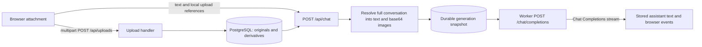

# Conversation and attachment transport review

This is a historical review. The implemented request contract is documented in [the current conversation transport specification](conversation-transport.md).

Reviewed 3 October 2026. Scope: browser uploads, persisted conversation history, request construction, durable generation workers, and current official OpenAI documentation. This is a source review and implementation plan; no inference calls or runtime changes were made. The deployed backend and its capabilities were not probed.

## Recommendation

Keep PostgreSQL as the canonical conversation store and preserve the existing OpenAI-compatible Chat Completions path. Add explicit backend/model capabilities and native file transport for backends that support it. For direct OpenAI use, add a Responses adapter as the longer-term default. Fix attachment loss during editing and extraction failure reporting first.

The current image transport is standard. The main opportunities are document fidelity, capability checks, and avoiding repeatedly expanding attachments into large request/job payloads. Switching endpoints alone will not solve those issues.

The checked-in endpoint is `http://127.0.0.1:1234/v1` ([config](../config/config.yaml#L5)); the model list includes non-OpenAI models. This project targets an OpenAI-compatible protocol, so support for OpenAI-native Files or Responses endpoints cannot be assumed.

## How requests work today



1. The browser uploads each attachment separately using multipart form data ([api.ts](../frontend/src/lib/api.ts#L115)). The server stores original bytes and local derivatives; it does not call OpenAI's Files API ([uploads.ts](../server/src/uploads.ts#L48)).
2. The composer submits a new message containing text and `/api/uploads/<id>` references. Its internal document shape is `{"type":"file","file":{"url":"/api/uploads/..."}}` ([Composer.svelte](../frontend/src/components/chat/Composer.svelte#L113)). This is an application format, not OpenAI's native file schema.
3. The relay loads previous messages from PostgreSQL, adds the supplied system prompt, and resolves attachments for every included message ([relay.ts](../server/src/relay.ts#L127)). It does not trust a browser-supplied history.
4. The resolved payload is persisted as `openai_messages` in a generation job. A worker sends `{model, messages, stream:true}` using `fetch` ([generation-worker.ts](../server/src/generation-worker.ts#L214)). The application has no OpenAI SDK dependency.
5. Default history mode includes all prior messages and their attachments. `latest_only` includes the system prompt and latest user message and adds `session_id`; this is a custom upstream-agent convention ([README](../README.md#L25)).

| Attachment | Stored locally | What the model receives today |
| --- | --- | --- |
| JPEG, PNG, GIF, WebP | Original bytes | `image_url` with a base64 data URL |
| PDF | Original plus JPEG page renders | Page metadata as text and one `image_url` per rendered page; first 100 pages only |
| DOCX, ODT, EPUB | Original, extracted text, embedded images | JSON serialized into a text part, followed by up to 20 embedded images |
| XLSX, ODS | Original and extracted sheet text | JSON serialized into a text part containing CSV-like sheet text |
| XLS | Original and a placeholder | A conversion instruction; no actual workbook contents |
| Plain text, Markdown, CSV, JSON, XML, YAML | Original and decoded text | JSON serialized into a text part containing the text |
| HTML | Original and stripped text | JSON serialized into a text part containing stripped text |

Document text is capped at 1,000,000 characters. PDFs are rendered at 150 DPI as JPEG with quality 85. These are application limits, not model context limits ([extract.ts](../server/src/extract.ts#L102), [PDF rendering](../server/src/extract.ts#L509)).

## Review findings

### 1. High: editing a user message drops its attachments

The UI deletes the original user message and its subsequent history, then sends a replacement containing only the edited text ([ChatView.svelte](../frontend/src/components/chat/ChatView.svelte#L158), [chat store](../frontend/src/stores/chat.svelte.ts#L406)). Unreferenced uploads may be deleted during that operation. The message PATCH endpoint also replaces content with text only and removes upload links ([conversations.ts](../server/src/conversations.ts#L243)).

Example: edit “Summarize this PDF” to “Summarize this PDF in German.” The regenerated request contains the new sentence but no PDF. Ordinary regeneration preserves the retained user message; this finding concerns editing.

Change: preserve non-text parts when editing text. Apply the replacement and history truncation atomically, keeping upload references until the replacement is accepted. Make attachment removal an explicit operation.

### 2. High: failed extraction can appear successful

The upload handler catches extraction/rendering exceptions and only logs them, then returns HTTP 201 without setting an error or warning ([uploads.ts](../server/src/uploads.ts#L75)). The relay subsequently sends `[Text extraction unavailable]` if no usable content exists ([relay.ts](../server/src/relay.ts#L59)). XLS is accepted even though extraction deliberately returns a conversion placeholder with no warning ([extract.ts](../server/src/extract.ts#L214)).

Change: persist a processing status and error, report unavailable content clearly, and block sending it unless a supported native-file route can consume the original. Native routes should not depend on successful local extraction. Reject unsupported XLS on fallback routes or implement its parser.

### 3. High: there is no aggregate request or context budget

The UI limits attachments to 20 per message, while the chat schema allows up to 200 content parts. Individual uploads are size-limited, but the relay can combine multiple large documents and all earlier attachments without checking the final upstream payload, image count, or model context. The inbound HTTP limit does not constrain attachment expansion performed afterward ([Composer.svelte](../frontend/src/components/chat/Composer.svelte#L21), [relay.ts](../server/src/relay.ts#L98), [index.ts](../server/src/index.ts#L66)).

Every turn rereads and base64-encodes prior images and expands document derivatives. Base64 adds roughly one-third to binary size before JSON overhead. The active job holds another expanded copy in PostgreSQL. Importantly, job snapshots are cleared on completion, failure, timeout, and cancellation; this is temporary duplication, not an indefinitely retained copy per finished turn ([finalization](../server/src/generation-worker.ts#L96), [cancellation](../server/src/generation-worker.ts#L349)).

Change: validate the resolved request against configured byte, image/page, file, and context budgets. Count replayed attachments too. Start with clear rejection and actionable feedback; make summarization/retrieval an explicit later feature. Do not silently omit older attachments.

Use immutable message/attachment snapshots and versioned derivative references in durable jobs, expanding bytes near transmission. Pin referenced assets so editing/deletion cannot break an accepted job. Preserve deterministic retry behavior.

### 4. Medium: document conversion loses fidelity

PDF requests contain page images without a separately extracted text layer. Reading therefore depends on vision/OCR, and pages after 100 are absent. The warning and a truncation note help, but native PDF input avoids maintaining this custom rendering pipeline.

DOCX and ODT extraction flattens paragraphs and tables into whitespace; embedded images are appended from archive entries rather than anchored to their source location ([extract.ts](../server/src/extract.ts#L163), [embedded images](../server/src/extract.ts#L537)). The spreadsheet parser reads cell `<v>` values and shared strings, but does not read inline-string cell text or interpret number/date formatting. It emits a grid before applying the text cap ([extract.ts](../server/src/extract.ts#L330)).

Change: prefer native files where supported, or use mature format parsers for the compatible fallback. Preserve structure and provenance. Bound parsing/rendering work, including spreadsheet dimensions and PDF pixel dimensions, before allocating derivatives.

### 5. Medium: backend/model capabilities are unspecified

Model configuration records identifiers, roles, and history mode, but no vision or native-file support ([types.ts](../server/src/types.ts#L222)). The UI offers images/documents regardless of model capabilities. The relay can send image parts to a model that cannot consume them.

Document image extraction can also pass unsupported binary formats: any unrecognized extension becomes a JPEG MIME label without conversion ([relay.ts](../server/src/relay.ts#L73)). A DOCX containing SVG, EMF, or TIFF can consequently produce an invalid image part.

Change: explicitly configure and validate capabilities, expose them to the composer, and enforce them server-side. Verify image bytes and MIME types; convert supported source formats deliberately or report their omission. Keep image `detail` configurable. Validate model YAML rather than relying only on TypeScript casts ([config.ts](../server/src/config.ts#L192)).

### 6. Medium: the request boundary mixes application and provider schemas

The ordinary upload path transforms local references correctly and checks ownership. However, `data:` parts bypass transformation and are forwarded unchanged, including the custom `file.url` structure and optional UI metadata ([relay.ts](../server/src/relay.ts#L32)). Other URL forms are skipped. Missing historical uploads can also be skipped; new local references receive an additional transactional ownership/existence check.

Change: use attachment IDs as the public application contract and serialize fresh provider-specific objects. Reject unsupported forms and unavailable references explicitly. If legacy inline images remain supported, validate them and strip UI fields. Never forward `file.url` as though it were OpenAI's file schema.

### 7. Medium: retries and observability need to distinguish transport failures from invalid input

The worker retries upstream errors without distinguishing transient failures from deterministic 400/413 attachment/context errors ([generation-worker.ts](../server/src/generation-worker.ts#L127)). It only consumes text deltas and `[DONE]`; usage and finish reasons are ignored. This makes attachment cost and truncation harder to assess.

Change: retry transient failures selectively; record request ID, status, payload bytes, included pages/images, usage when available, and completion reason. Keep document bytes/text out of diagnostic logs. A Responses adapter must handle its own event types and translate them into the application's existing generation lifecycle.

## What is standard, and what would improve this project?

Base64 `image_url` parts are documented Chat Completions inputs. Responses uses `input_image` and additionally supports file IDs. Private `/api/uploads/...` URLs require the application's session and cannot simply be handed to OpenAI. Keep inline images as the initial compatible transport; consider file IDs for reuse. [Official image guidance](https://developers.openai.com/api/docs/guides/images-vision).

OpenAI accepts PDFs natively in Chat Completions using `file.file_data` or `file.file_id`. Responses uses `input_file` and supports additional document types. Native PDF processing includes text and page images. Non-PDF documents do not include embedded visuals; spreadsheets have a limited augmentation flow. Preserve diagram-heavy documents through PDF conversion or explicit image parts. File inputs have a combined 50 MB request limit, with each file under 50 MB. [Official file guidance](https://developers.openai.com/api/docs/guides/file-inputs).

Illustrative native PDF part for Chat Completions:

```json
{
  "type": "file",
  "file": {
    "filename": "report.pdf",
    "file_data": "data:application/pdf;base64,..."
  }
}
```

Illustrative Responses user content after uploading a document and image:

```json
[
  { "type": "input_text", "text": "Compare the report with this chart." },
  { "type": "input_file", "file_id": "file-document-id" },
  { "type": "input_image", "file_id": "file-image-id", "detail": "auto" }
]
```

Use `user_data` for document uploads and the documented image-upload purpose for image file IDs. Check accepted formats per adapter; the project's current allowlist is not a guarantee of native support. [File guidance](https://developers.openai.com/api/docs/guides/file-inputs), [image guidance](https://developers.openai.com/api/docs/guides/images-vision).

Responses is OpenAI's recommended direction, while Chat Completions remains supported. Migration includes request, output, and streaming changes, so it should be isolated behind an adapter. [Official migration guide](https://developers.openai.com/api/docs/guides/migrate-to-responses).

Manual conversation replay is standard and fits this application's editing, forking, and model switching. Initially keep it with Responses and set `store:false` deliberately. Preserve replayable output/reasoning items when needed, separately from display text, and invalidate the relevant lineage after edits. Later, `previous_response_id` can reduce retransmission; it does not eliminate billing for prior context. Conversations API persistence adds another state lifecycle to manage. [Official conversation guidance](https://developers.openai.com/api/docs/guides/conversation-state).

File IDs reduce repeated binary transmission, not necessarily model input token charges. Cache them per owner, provider/account, upload hash, purpose, and transformation version. Handle expired/deleted files and credential changes. Remote deletion needs durable cleanup after the last message/job reference disappears, including forked conversations. Files support deletion and expiry; `store:false` is not a substitute for file cleanup or a promise of zero retention. [Official data controls](https://developers.openai.com/api/docs/guides/your-data).

## Implementation plan

### Phase 1: repair attachment correctness

- Preserve attachments during user text edits; atomically replace the message and truncate its later history.
- Return and persist processing status/warnings; make corrupt files and unsupported XLS actionable.
- Validate attachment IDs, ownership, content kind, MIME, and bytes consistently for new and replayed messages.
- Test editing with PDF/image attachments, extraction failures, unsupported inline file parts, and cross-user references. Verify ordinary regeneration and fork/delete upload retention.

Deliverable: accepted attachments remain attached and are either transmitted successfully or produce a clear error. This phase is useful for every backend.

### Phase 2: define the provider boundary and request budgets

- Introduce typed application content using text and attachment IDs. Support a versioned reader for existing stored `image_url`/`file.url` records; migrate writes first.
- Add validated backend/model capabilities: API mode, vision, accepted native file types, Files API support, request/context limits, and image detail.
- Split attachment resolution and provider serialization from `relay.ts`. Create a Chat Completions adapter first, including the custom `session_id` behavior only for configured session-owning backends.
- Add aggregate checks, selective retries, and content-free diagnostics. Snapshot provider identity/config revision so retries do not accidentally send an accepted request to a different backend after config reload; keep credentials server-side.
- Replace expanded durable snapshots with immutable manifests plus pinned asset/derivative versions. Support already queued legacy snapshots until drained.
- Test exact upstream bodies with a mock server, budget failures before transmission, model switching, and recovery after worker restart.

Deliverable: existing compatible configurations keep working through an explicit, testable transport contract.

### Phase 3: enable native OpenAI transport incrementally

- Start with native PDF parts on capable Chat Completions backends, retaining local conversion for others.
- Add Responses support for text, images, and supported documents. Translate typed stream lifecycle/error events into existing application events; verify completion, cancellation, partial output, and restart behavior.
- Keep application-managed history initially. Persist provider output items when required for replay; never send a display-only transcript as a purported complete tool/reasoning history.
- Begin with inline bytes for simpler file lifecycle management; add reusable file IDs when measured payload size/reuse justifies it. Implement upload concurrency control, expiry/reupload, and durable remote deletion before enabling that cache broadly.
- Route titles and automations through the shared transport interface as applicable; they currently have separate Chat Completions calls. Account for title parameter differences as part of adapter work.
- Compare native PDF results against the fallback on selectable-text PDFs, scans, small tables, diagrams, long documents, and documents with embedded visuals. Measure bytes, latency, usage, and answer correctness rather than assuming native is cheaper.

Deliverable: direct OpenAI deployments use standard multimodal inputs without losing compatible-server support.

### Phase 4: optimize long conversations only when measurements warrant it

Evaluate response chaining, compaction, and retrieval for repeated questions over large document collections. Add explicit rules for edits, forks, deletion, model/provider switches, and upstream state expiry. Retrieval changes which document content enters context, so treat it as a separate product capability with coverage/citation evaluation.

## Validation limits

The existing server tests cover job lifecycles but do not establish attachment serialization or extraction fidelity; the integration fixture primarily constructs text-only job snapshots. Frontend tests cover submission and abandoned-upload cleanup. Add focused transport and document fixtures during implementation.

No tests were run for this documentation-only review. Dependencies are absent in this checkout, and the available Node runtime is 24 while the project targets Node 26. Compatibility and performance against the deployed backend remain to be measured.
