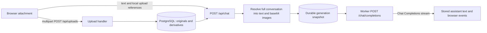

# Complete project review and improvement plan

Reviewed 3 October 2026. This report consolidates the earlier conversation/document transport review, proposed file formats in four tiers, and a broader review of correctness, reliability, authorization, scalability, usability, and operations. It records the implementation before changes. The subsequently authorized changes, completed issue mapping, upgrade guidance and verification results are in [the implementation report](implementation-notes.md).

The format rankings assume a general-purpose, self-hosted chat application used for office work, research, and occasional coding. They are product recommendations, not measured demand. A developer-only or media-focused audience would justify different rankings.

## 1. Overall assessment and priorities

The architecture is worth retaining: Svelte for the UI, Hono for the API, PostgreSQL as canonical state, and durable workers for upstream calls. The largest immediate gains come from correcting state transitions and constraining expensive work before adding more formats or provider features.

Keep OpenAI-compatible Chat Completions support. Add native file inputs and a Responses adapter behind explicit backend/model capabilities. Keep application-managed history initially because editing, regeneration, forking, and model switching are already central features.

| Order | Work | Why it comes first |
| --- | --- | --- |
| 1 | Preserve attachments and history during edits; report failed document processing | Prevent incorrect requests and avoid destructive changes before replacement acceptance |
| 2 | Preserve system prompts when continuing generated conversations | Keep follow-up behavior consistent with the original generation |
| 3 | Bound extraction, aggregate input, worker concurrency, and automation requests | Protect responsiveness, generation leases, and upstream capacity |
| 4 | Make authorization and job configuration lifecycles explicit | Handle role changes, restricted automation deliveries, and backend reloads consistently |
| 5 | Repair search, folder mutation, defaults, and error handling | Address visible correctness issues in everyday use |
| 6 | Improve existing parsers and add Tier 1 formats | Deliver reliable coverage before broadening the format list |
| 7 | Add native PDF/Responses transport; measure reuse and cost | Modernize provider integration without assuming compatible backends support it |
| 8 | Add pagination, observability, accessibility, and selected lower-tier formats | Improve operation and usability as adoption grows |

Here, **P1** means address early because of data loss, incorrect behavior, authorization, or resource exposure; **P2** means an important correctness/maintainability improvement; **P3** means optional product or operational polish. File-format tiers are independent of these issue priorities.

### Existing strengths to preserve

- Conversation history is assembled from server-side PostgreSQL records, with ownership checks; the browser does not supply authoritative history.
- Session tokens are random, stored as hashes, checked server-side, and revocable. OIDC uses PKCE and signed ID-token verification. Mutation requests require a custom header, and Markdown is sanitized.
- Workers use database leases, heartbeats, and attempt fencing. Browser disconnects detach observers instead of cancelling accepted generations. Deletion paths take generation locks and remove rate leases.
- Upload quotas account for originals and derivatives, and quota updates use advisory locks. Upload references are shared across forks and cleaned up when unreferenced.
- Configuration reload reconciles changes before replacing active configuration; failure preserves the old configuration in that process.
- Both CI configurations run type checks, unit tests, integration tests, and frontend builds. Gitea also has dependency audit steps. The image runs as a non-root user.

Evidence: [auth](../server/src/auth.ts), [relay](../server/src/relay.ts), [workers](../server/src/generation-worker.ts), [uploads](../server/src/uploads.ts), [reload](../server/src/config.ts#L233), [GitHub CI](../.github/workflows/docker.yml), [Gitea CI](../.gitea/workflows/docker.yml), [Dockerfile](../Dockerfile).

## 2. Conversation, document, and image transport

The checked-in endpoint is `http://127.0.0.1:1234/v1` and the configured models include non-OpenAI providers ([configuration](../config/config.yaml#L5), [models](../config/models.yaml)). The deployed endpoint was not probed. “OpenAI-compatible” establishes a protocol expectation, not support for every OpenAI endpoint or modality.

### Current request flow



1. The browser uploads each attachment separately using multipart form data ([api.ts](../frontend/src/lib/api.ts#L115)). The server stores original bytes and local derivatives; it does not call OpenAI's Files API ([uploads.ts](../server/src/uploads.ts#L48)).
2. The composer submits a new message containing text and `/api/uploads/<id>` references. Its internal document shape is `{"type":"file","file":{"url":"/api/uploads/..."}}` ([Composer.svelte](../frontend/src/components/chat/Composer.svelte#L113)). This is an application format, not OpenAI's native file schema.
3. The relay loads previous messages from PostgreSQL, adds the supplied system prompt, and resolves attachments for every included message ([relay.ts](../server/src/relay.ts#L127)). It does not trust a browser-supplied history.
4. The resolved payload is persisted as `openai_messages` in a generation job. A worker sends `{model, messages, stream:true}` using `fetch` ([generation-worker.ts](../server/src/generation-worker.ts#L214)). The application has no OpenAI SDK dependency.
5. Default history mode includes all prior messages and their attachments. `latest_only` includes the system prompt and latest user message and adds `session_id`; this is a custom upstream-agent convention ([README](../README.md#L25)).

| Attachment | Stored locally | What the model receives today |
| --- | --- | --- |
| JPEG, PNG, GIF, WebP | Original bytes | `image_url` with a base64 data URL |
| PDF | Original plus JPEG page renders | Page metadata as text and one `image_url` per rendered page; first 100 pages only |
| DOCX, ODT, EPUB | Original, extracted text, embedded images | JSON serialized into a text part, followed by up to 20 embedded images |
| XLSX, ODS | Original and extracted sheet text | JSON serialized into a text part containing CSV-like sheet text |
| XLS | Original and a placeholder | A conversion instruction; no actual workbook contents |
| Plain text, Markdown, CSV, JSON, XML, YAML | Original and decoded text | JSON serialized into a text part containing the text |
| HTML | Original and stripped text | JSON serialized into a text part containing stripped text |

Document text is capped at 1,000,000 characters. PDFs are rendered at 150 DPI as JPEG with quality 85. These are application limits, not model context limits ([extract.ts](../server/src/extract.ts#L102), [PDF rendering](../server/src/extract.ts#L509)).

### Original document findings

#### D1 — P1: editing a user message drops its attachments

The UI deletes the original user message and its subsequent history, then sends a replacement containing only the edited text ([ChatView.svelte](../frontend/src/components/chat/ChatView.svelte#L158), [chat store](../frontend/src/stores/chat.svelte.ts#L406)). Unreferenced uploads may be deleted during that operation. The message PATCH endpoint also replaces content with text only and removes upload links ([conversations.ts](../server/src/conversations.ts#L243)).

Example: edit “Summarize this PDF” to “Summarize this PDF in German.” The regenerated request contains the new sentence but no PDF. Ordinary regeneration preserves the retained user message; this finding concerns editing.

Change: preserve non-text parts when editing text. Apply the replacement and history truncation atomically, keeping upload references until the replacement is accepted. Make attachment removal an explicit operation.

#### D2 — P1: failed extraction can appear successful

The upload handler catches extraction/rendering exceptions and only logs them, then returns HTTP 201 without setting an error or warning ([uploads.ts](../server/src/uploads.ts#L75)). The relay subsequently sends `[Text extraction unavailable]` if no usable content exists ([relay.ts](../server/src/relay.ts#L59)). XLS is accepted even though extraction deliberately returns a conversion placeholder with no warning ([extract.ts](../server/src/extract.ts#L214)).

Change: persist a processing status and error, report unavailable content clearly, and block sending it unless a supported native-file route can consume the original. Native routes should not depend on successful local extraction. Reject unsupported XLS on fallback routes or implement its parser.

#### D3 — P1: there is no aggregate request or context budget

The UI limits attachments to 20 per message, while the chat schema allows up to 200 content parts. Individual uploads are size-limited, but the relay can combine multiple large documents and all earlier attachments without checking the final upstream payload, image count, or model context. The inbound HTTP limit does not constrain attachment expansion performed afterward ([Composer.svelte](../frontend/src/components/chat/Composer.svelte#L21), [relay.ts](../server/src/relay.ts#L98), [index.ts](../server/src/index.ts#L66)).

Every turn rereads and base64-encodes prior images and expands document derivatives. Base64 adds roughly one-third to binary size before JSON overhead. The active job holds another expanded copy in PostgreSQL. Importantly, job snapshots are cleared on completion, failure, timeout, and cancellation; this is temporary duplication, not an indefinitely retained copy per finished turn ([finalization](../server/src/generation-worker.ts#L96), [cancellation](../server/src/generation-worker.ts#L349)).

Change: validate the resolved request against configured byte, image/page, file, and context budgets. Count replayed attachments too. Start with clear rejection and actionable feedback; make summarization/retrieval an explicit later feature. Do not silently omit older attachments.

Use immutable message/attachment snapshots and versioned derivative references in durable jobs, expanding bytes near transmission. Pin referenced assets so editing/deletion cannot break an accepted job. Preserve deterministic retry behavior.

#### D4 — P2: document conversion loses fidelity

PDF requests contain page images without a separately extracted text layer. Reading therefore depends on vision/OCR, and pages after 100 are absent. The warning and a truncation note help, but native PDF input avoids maintaining this custom rendering pipeline.

DOCX and ODT extraction flattens paragraphs and tables into whitespace; embedded images are appended from archive entries rather than anchored to their source location ([extract.ts](../server/src/extract.ts#L163), [embedded images](../server/src/extract.ts#L537)). The spreadsheet parser reads cell `<v>` values and shared strings, but does not read inline-string cell text or interpret number/date formatting. It emits a grid before applying the text cap ([extract.ts](../server/src/extract.ts#L330)).

Change: prefer native files where supported, or use mature format parsers for the compatible fallback. Preserve structure and provenance. Bound parsing/rendering work, including spreadsheet dimensions and PDF pixel dimensions, before allocating derivatives.

#### D5 — P2: backend/model capabilities are unspecified

Model configuration records identifiers, roles, and history mode, but no vision or native-file support ([types.ts](../server/src/types.ts#L222)). The UI offers images/documents regardless of model capabilities. The relay can send image parts to a model that cannot consume them.

Document image extraction can also pass unsupported binary formats: any unrecognized extension becomes a JPEG MIME label without conversion ([relay.ts](../server/src/relay.ts#L73)). A DOCX containing SVG, EMF, or TIFF can consequently produce an invalid image part.

Change: explicitly configure and validate capabilities, expose them to the composer, and enforce them server-side. Verify image bytes and MIME types; convert supported source formats deliberately or report their omission. Keep image `detail` configurable. Validate model YAML rather than relying only on TypeScript casts ([config.ts](../server/src/config.ts#L192)).

#### D6 — P2: the request boundary mixes application and provider schemas

The ordinary upload path transforms local references correctly and checks ownership. However, `data:` parts bypass transformation and are forwarded unchanged, including the custom `file.url` structure and optional UI metadata ([relay.ts](../server/src/relay.ts#L32)). Other URL forms are skipped. Missing historical uploads can also be skipped; new local references receive an additional transactional ownership/existence check.

Change: use attachment IDs as the public application contract and serialize fresh provider-specific objects. Reject unsupported forms and unavailable references explicitly. If legacy inline images remain supported, validate them and strip UI fields. Never forward `file.url` as though it were OpenAI's file schema.

#### D7 — P2: retries and observability need to distinguish transport failures from invalid input

The worker retries upstream errors without distinguishing transient failures from deterministic 400/413 attachment/context errors ([generation-worker.ts](../server/src/generation-worker.ts#L127)). It only consumes text deltas and `[DONE]`; usage and finish reasons are ignored. This makes attachment cost and truncation harder to assess.

Change: retry transient failures selectively; record request ID, status, payload bytes, included pages/images, usage when available, and completion reason. Keep document bytes/text out of diagnostic logs. A Responses adapter must handle its own event types and translate them into the application's existing generation lifecycle.

### Standard alternatives and recommended transport

Base64 `image_url` parts are documented Chat Completions inputs. Responses uses `input_image` and additionally supports file IDs. Private `/api/uploads/...` URLs require the application's session and cannot simply be handed to OpenAI. Keep inline images as the initial compatible transport; consider file IDs for reuse. [Official image guidance](https://developers.openai.com/api/docs/guides/images-vision).

OpenAI accepts PDFs natively in Chat Completions using `file.file_data` or `file.file_id`. Responses uses `input_file` and supports additional document types. Native PDF processing includes text and page images. Non-PDF documents do not include embedded visuals; spreadsheets have a limited augmentation flow. Preserve diagram-heavy documents through PDF conversion or explicit image parts. File inputs have a combined 50 MB request limit, with each file under 50 MB. [Official file guidance](https://developers.openai.com/api/docs/guides/file-inputs).

Illustrative native PDF part for Chat Completions:

```json
{
  "type": "file",
  "file": {
    "filename": "report.pdf",
    "file_data": "data:application/pdf;base64,..."
  }
}
```

Illustrative Responses user content after uploading a document and image:

```json
[
  { "type": "input_text", "text": "Compare the report with this chart." },
  { "type": "input_file", "file_id": "file-document-id" },
  { "type": "input_image", "file_id": "file-image-id", "detail": "auto" }
]
```

Use `user_data` for document uploads and the documented image-upload purpose for image file IDs. Check accepted formats per adapter; the project's current allowlist is not a guarantee of native support. [File guidance](https://developers.openai.com/api/docs/guides/file-inputs), [image guidance](https://developers.openai.com/api/docs/guides/images-vision).

Responses is OpenAI's recommended direction, while Chat Completions remains supported. Migration includes request, output, and streaming changes, so it should be isolated behind an adapter. [Official migration guide](https://developers.openai.com/api/docs/guides/migrate-to-responses).

Manual conversation replay is standard and fits this application's editing, forking, and model switching. Initially keep it with Responses and set `store:false` deliberately. Preserve replayable output/reasoning items when needed, separately from display text, and invalidate the relevant lineage after edits. Later, `previous_response_id` can reduce retransmission; it does not eliminate billing for prior context. Conversations API persistence adds another state lifecycle to manage. [Official conversation guidance](https://developers.openai.com/api/docs/guides/conversation-state).

File IDs reduce repeated binary transmission, not necessarily model input token charges. Cache them per owner, provider/account, upload hash, purpose, and transformation version. Handle expired/deleted files and credential changes. Remote deletion needs durable cleanup after the last message/job reference disappears, including forked conversations. Files support deletion and expiry; `store:false` is not a substitute for file cleanup or a promise of zero retention. [Official data controls](https://developers.openai.com/api/docs/guides/your-data).

### Additional attachment issues found during the broader review

**D8 — P1: expensive document processing runs in the web process.** PDF rendering and substantial portions of archive/XML/spreadsheet parsing use synchronous work after dynamic imports. An `async` function does not move that CPU work off the event loop. The archive budget is useful, but PDF pixel dimensions, dense spreadsheet expansion, derivative bytes, and processing time lack equivalent bounds. A large or pathological accepted document can delay HTTP handling and worker heartbeat timers. Lease recovery on another replica can then repeat upstream work. This is a source-supported resource risk; its threshold has not been load-tested. [PDF rendering](../server/src/extract.ts#L509), [spreadsheet expansion](../server/src/extract.ts#L423), [worker heartbeats](../server/src/generation-worker.ts#L190).

Recommendation: process documents in bounded workers or isolated subprocesses with memory/time/pixel/row limits, explicit status, and cancellation. Schedule fallback conversion only when the selected route needs it. Avoid blocking initial uploads on conversions that a native-file backend can perform itself.

**D9 — P2: file recognition depends entirely on client MIME.** The server accepts only exact `File.type` values. There is no extension/content normalization; a valid document with an empty or alternative MIME can be rejected, while mislabeled bytes enter the wrong processing path. Plain text is always decoded as UTF-8. The frontend accepts some extensions that browsers need not label consistently. [upload classification](../server/src/uploads.ts#L53), [file picker](../frontend/src/components/chat/Composer.svelte#L238), [text decoding](../server/src/extract.ts#L148).

Recommendation: one format registry should define extensions, MIME aliases, byte signatures/container validation, extraction routes, and limits. Decode BOM-marked UTF-16 as well as UTF-8; handle other encodings through an explicit policy. Extensions are hints, not sufficient verification of arbitrary binary inputs. Share presentation metadata with the frontend instead of maintaining separate allowlists.

**D10 — P2: attachment status and access are weak after sending.** Extraction warnings are returned during upload but not retained as a stable user-facing processing record. Sent file chips are spans rather than download/preview controls, although an authenticated download endpoint exists. The chat schema also strips `_mime_type`, so file icons lose some information. [upload response](../server/src/uploads.ts#L118), [relay schema](../server/src/relay.ts#L98), [message display](../frontend/src/components/chat/MessageContent.svelte#L75).

Recommendation: store/expose attachment type, processing status, coverage, and warnings by attachment ID; provide download and safe previews. Show “pages 1–100 included” or “text only” after sending and on later visits, not just on the temporary composer chip.

**D11 — P2: inline media bypasses the upload storage quota.** `/api/chat` accepts `data:` media parts, which are stored inside message content and forwarded directly. The upload quota sums only the uploads table. The HTTP body limit still bounds an individual request, but does not provide an aggregate storage quota for those persisted inline messages. [content acceptance](../server/src/relay.ts#L98), [data URL path](../server/src/relay.ts#L40), [quota accounting](../server/src/uploads.ts#L29).

Recommendation: require managed attachment IDs for new uploads, or account for and validate inline media under the same storage rules. Continue reading historical inline content without preserving this write-path loophole.

## 3. File formats: four tiers

“Supported” should mean the content is read correctly, the relevant parts reach the selected model, omissions are reported, and follow-up/edit/fork behavior works. Acceptance by the file picker is insufficient. A format may be supported through local conversion even when the model API does not accept its original bytes.

### Existing formats: repair this baseline first

| Family | Current state | Work needed |
| --- | --- | --- |
| PDF | Accepted; image rendering only, first 100 pages | Native route or text-plus-visual fallback, coverage reporting, render budgets |
| DOCX/ODT | Accepted; flattened text and detached embedded images | Preserve headings/tables/relationships; validate and convert unsupported embedded images |
| XLSX/ODS | Accepted; custom, incomplete extraction | Mature parser, inline strings, formats/dates, bounded dimensions, proper CSV serialization |
| XLS | Accepted but not parsed | Implement or clearly reject; treat as repairing a promise already made |
| TXT/MD/CSV/TSV/JSON/XML/YAML/HTML | Accepted by MIME, subject to browser labeling | Normalize aliases, encoding, delimiters; preserve structure rather than always stripping HTML |
| JPG/PNG/WebP/GIF | Accepted | Verify bytes/dimensions/orientation; distinguish animated GIF from still-image analysis |
| EPUB | Accepted; basic spine text and image extraction | Improve content order, metadata, and coverage; not a missing format |

The image baseline should explicitly distinguish non-animated GIF support from animation processing. OpenAI documents PNG/JPEG/WebP and non-animated GIF as image inputs; animation should require frame extraction or a clear limitation. [Official image requirements](https://developers.openai.com/api/docs/guides/images-vision).

### Tier 1 — absolutely needed for the assumed audience

| Additional formats | Why | Recommended processing | Relative effort |
| --- | --- | --- | --- |
| PowerPoint `.pptx` | The largest gap in ordinary modern office documents | Extract slide titles, text, notes, and tables in slide order; render slides/PDF when visual layout matters | Medium–high |
| Common source files: `.py`, `.js`, `.mjs`, `.ts`, `.tsx`, `.jsx`, `.java`, `.c`, `.h`, `.cpp`, `.cs`, `.go`, `.rs`, `.sh`, `.sql`, `.css` | Users should attach code rather than rename it to `.txt` | Bounded text decoding with language/filename metadata; never execute uploaded code | Low |
| Configuration/diagnostic text: `.toml`, `.ini`, `.conf`, `.properties`, `.log`, `.diff`, `.patch`, `Dockerfile`, `Makefile` | Common debugging inputs; mostly reusable text handling | Recognize extensions and selected extensionless filenames; preserve line breaks | Low |
| Structured logs/data: `.jsonl`, `.ndjson` | Common exports and line-oriented logs | Validate/sample bounded records, retain row numbers and coverage; allow raw text mode | Low–medium |

PowerPoint is the first substantial new parser. The text families are the highest-value low-cost additions. Tier 1 is conditional on the stated audience; code files would move down for an exclusively office-facing product. XLS repair remains a baseline task rather than being counted as a new format.

### Tier 2 — strongly recommended

| Additional formats | Why | Recommended processing | Relative effort |
| --- | --- | --- | --- |
| `.doc`, `.rtf` | Legacy Word documents and exchanged rich text | Mature parser or isolated conversion to structured text/PDF; no active content | Medium–high |
| `.ppt`, `.odp` | Legacy and LibreOffice presentations | Reuse a presentation conversion route, preserving slide boundaries and notes where available | Medium–high |
| `.heic`, `.heif` | Phone photos | Decode, apply orientation, convert to supported raster format; disclose any loss of extra images | Medium |
| `.tif`, `.tiff`, `.bmp` | Scans and older screenshots | Convert to supported raster inputs; handle multipage TIFF as a document with page budgets | Medium |
| `.svg` | Diagrams, charts, and exported graphics | Controlled rasterization, plus useful text labels; disable external fetches and scripts during conversion | Medium |
| `.eml` | Individual email messages are common review material | Parse MIME, headers, text/HTML alternatives, and separately managed attachments | Medium |
| `.htm`, `.markdown`, `.text`, `.yml` and MIME aliases | Equivalent names should behave consistently | Alias normalization through the shared registry; `.yml` is already listed in the picker | Low |

These inputs mostly extend existing document/image pipelines. They require actual conversion or parsing; relabeling TIFF/SVG/HEIC as JPEG does not make them valid model inputs.

### Tier 3 — useful when demand exists

| Additional formats | Why | Recommended processing | Relative effort |
| --- | --- | --- | --- |
| Audio `.mp3`, `.m4a`, `.wav`, `.webm` (audio) | Meetings, voice notes, interviews | Separate transcription job; retain transcript/timestamps and supported speaker metadata, then pass text into chat | High |
| Notebooks `.ipynb` | Research and coding workflows | Parse JSON into ordered Markdown/code cells and selected outputs; do not execute cells | Medium |
| `.zip`, `.tar`, `.tar.gz`, `.gz` | Multiple related files or compressed logs | Bounded extraction, allowlisted child formats, entry preview/selection, depth/size/path limits | High |
| `.srt`, `.vtt` | Transcript/subtitle review | Parse cues into timestamped text; preserve timeline references | Low–medium |
| `.rst`, `.tex`, `.bib` | Technical writing and papers | Read as source text; optional isolated rendering as a separately scoped feature | Low initially |
| `.ics`, `.vcf` | Calendar/contact exports | Structured text parsing; no importing into external services | Low–medium |
| `.mhtml`, `.mht` | Saved web pages | Parse the MIME container, resolve internal parts, extract main content; no remote loading | Medium |
| `.xlsm`, `.xlsb` | Specialized Excel workflows | Read-only workbook extraction with a capable parser; never run macros | Medium–high |

Audio is a new modality and job lifecycle, not an additional `input_file` MIME entry. OpenAI documents a separate transcription endpoint, supported containers, and upload limits. Enforce the selected transcription service's capabilities and convert/chunk only through explicit bounded routes. [Official transcription guidance](https://developers.openai.com/api/docs/guides/speech-to-text).

Archives should follow, rather than precede, a reliable individual-file registry and processing worker. Do not advertise “all ZIP files” when only selected child formats are supported.

### Tier 4 — nice to have, very optional

| Additional formats | When they matter | Recommended route / limitation | Relative effort |
| --- | --- | --- | --- |
| Video `.mp4`, `.mov`, `.mkv`, `.webm` (video), animated GIF | Recorded demos, lectures, visual timelines | Audio transcription plus sampled/key frames and timestamps; state that unsampled events may be missed | High |
| Apple `.pages`, `.key`, `.numbers` | Apple-heavy teams | Dedicated conversion or user-provided PDF/Office export; preserve originals | High/variable |
| Email collections `.msg`, `.mbox`, `.pst` | Mailbox review | Dedicated parsers, message selection, attachment/reference handling, strict collection budgets | High |
| Data containers `.parquet`, `.arrow`, `.feather`, `.sqlite`, `.db` | Data-heavy workflows | Read-only inspection, schema and selected rows; no arbitrary database extensions or execution | High |
| `.geojson`, shapefile bundles, `.h5`, `.hdf5`, `.nc` | GIS/scientific work | Domain-specific summaries/previews and selective extraction; generic text flattening is inadequate | High |
| CAD/3D `.dxf`, `.dwg`, `.stl`, `.obj`, `.glb`; layered graphics `.psd`, `.ai`, `.eps` | Specialized design/engineering teams | Dedicated renderers/export paths; a preview does not imply full semantic understanding | Very high |

Tier 4 is an opportunity list, not a commitment. Prefer asking users to export to established formats until usage justifies the maintenance cost. Arbitrary executables, encrypted containers, and unknown binary files should not be accepted as model-readable documents without a defined processing route.

### Format implementation rules

Use a shared registry with separate “recognized,” “processed,” and “supported by selected backend/model” states. Store a coverage manifest: included pages/slides/sheets/rows/images, transformations, encoding, and omissions. Keep originals downloadable, derivatives versioned, and attachment content in user-level context.

For each family, test representative real-world fixtures, corrupt files, mislabeled MIME, partial extraction, long inputs, and ownership/lifecycle behavior. Images need orientation and detail tests; presentations need notes and diagrams; spreadsheets need inline strings, quotes/newlines, dates, formulas/cached values, sparse cells, and bounded expansion. Native support still needs quality evaluation; an accepted file need not supply every row or visual element to the model.

## 4. General review findings

### G1 — P1: continued conversations do not reliably retain their system prompt

`ChatView` derives instructions from a current preset or prompt selection and does not fall back to a conversation's stored `custom_system_prompt`. Automation delivery creates a conversation without persisting the automation's `system_prompt`, although the initial inference used it. The relay uses the prompt supplied by the browser rather than resolving persisted conversation settings. A follow-up to an automation can therefore change behavior silently. Changes to shared prompt/preset definitions also change replay behavior without a per-generation record of the effective source/version. [ChatView](../frontend/src/components/chat/ChatView.svelte#L58), [automation delivery](../server/src/automation-runner.ts#L147), [relay construction](../server/src/relay.ts#L127).

Recommendation: define one server-side rule for effective instructions, persist automation instructions, expose the effective prompt in the UI, and snapshot the effective prompt/source/version for a generation. Make deliberate live-prompt updates distinct from historical replay. Test reopening a custom-prompt conversation and following up on an automation result.

### G2 — P2: search can return duplicate conversations and stale results

The search query selects `DISTINCT conv.*, rank`, with rank calculated for each matching message. Different ranks make otherwise identical conversations distinct. The sidebar keys results by conversation ID. Search also has no request-generation guard: a slower old query can replace a newer result. It searches message text only, missing title-only matches and extracted attachment contents. [SQL search](../server/src/conversations.ts#L80), [store search](../frontend/src/stores/conversations.svelte.ts#L96), [keyed results](../frontend/src/components/layout/Sidebar.svelte#L131).

Recommendation: aggregate a best rank per conversation before limiting, include titles, and guard/abort obsolete requests. Consider extracted attachment search separately with provenance and owner filtering. Test two matching messages with different ranks and responses arriving out of order.

### G3 — P2: folder hierarchy validation is not atomic

Parent ancestry is checked before an independent update. Two concurrent moves can both validate root folders A/B and then create A → B → A. Deletion traverses descendants using `UNION ALL` without cycle protection. This is a source-supported concurrency risk, not a reproduced database failure. Folder/conversation membership updates also do not coordinate consistently with folder deletion. [validation/update](../server/src/folders.ts#L16), [delete traversal](../server/src/folders.ts#L75), [conversation settings](../server/src/conversations.ts#L118).

Recommendation: validate and update hierarchy under one per-owner hierarchy transaction/lock, coordinate membership changes, and make recursive queries cycle-safe. Test concurrent opposite moves and moving a conversation while deleting its destination folder.

### G4 — P1: authorization changes do not invalidate existing sessions

Sessions store the role at login, and request authentication reads that stored role. Later login updates `users.last_known_role`, but existing sessions keep the old role until expiry/revocation. RBAC configuration changes do not immediately reevaluate sessions. Personal scheduled jobs use the user's last-known role, which can itself be stale until login. [session creation/verification](../server/src/auth.ts#L133), [user role update](../server/src/auth.ts#L280), [scheduled authorization](../server/src/automation-runner.ts#L42).

Recommendation: define and document a role freshness/revocation policy. Resolve current application role or an authorization version for each authenticated request, revoke incompatible sessions after observed role changes, and apply freshness rules to scheduled jobs. Immediate identity-provider group changes require a provider integration or reauthentication policy; database role checks alone cannot learn them.

### G5 — P1: automation generation bypasses chat admission limits

Chat and uploads use rate admission, but manual automation triggers do not use those limits. Each trigger can enqueue a fresh run; scheduled jobs and titles also have no shared upstream concurrency budget. Each worker scanner starts a batch every second and can accumulate active work while earlier jobs remain pending. The database lease mechanism prevents duplicate claims, but does not bound total concurrency. [trigger](../server/src/automations.ts#L83), [automation scanner](../server/src/automation-runner.ts#L281), [title scanner](../server/src/title-worker.ts#L162), [chat admission](../server/src/ratelimit.ts#L40).

Recommendation: shared provider/global admission, per-owner manual limits, per-automation overlap policy, capped active workers, and queue-age/backlog visibility. Keep recovery distinct from failed-attempt budgets. Do not turn the existing 20-row scan batch into a supposed concurrency limit.

### G6 — P1: shared automation deliveries use old recipient authorization

Recipients and visible roles are snapshotted at enqueue. Execution verifies model access for those snapshotted roles, then delivery creates conversations for the recorded recipients without rechecking current user role, automation visibility/deletion, or subscription. An unsubscribed or newly restricted user may still receive queued output. Deleting/disabling an automation only affects the definition, leaving queued runs eligible. Some snapshot semantics may be intentional, but authorization and cancellation behavior need explicit rules. [recipient snapshot](../server/src/automation-runner.ts#L62), [delivery](../server/src/automation-runner.ts#L131), [definition deletion/subscription](../server/src/automations.ts#L66).

Recommendation: retain immutable generation inputs while rechecking access before delivery. Mark ineligible deliveries skipped. Define whether unsubscribe stops pending delivery and whether delete/disable cancels queued runs. Test visibility narrowing and role/subscription changes between enqueue and delivery.

### G7 — P1: retries can change backend after configuration reload

Chat jobs snapshot messages/model but not provider identity; workers read the current endpoint/key at execution. Automation/title jobs do likewise. An accepted or retried conversation may be sent to a different backend after reload. Configuration itself is process-local, so SIGHUP on one replica does not synchronize other replicas. Models/prompts/presets are cast from YAML rather than fully validated; malformed entries can fail later at request or reconciliation time. [job snapshot](../server/src/relay.ts#L169), [worker configuration](../server/src/generation-worker.ts#L174), [config casting](../server/src/config.ts#L192), [reload](../server/src/config.ts#L233).

Recommendation: snapshot provider identity and a configuration revision, resolving credentials through current server-side references. Define how rotation/removal affects queued work. Validate all configuration families, duplicates, references, and limits before reconciliation. Establish an explicit deployment-wide reload/version mechanism for replicas.

### G8 — P2: streaming success means only that `[DONE]` arrived

The worker consumes text deltas and ignores finish reasons, refusals, tool-call-only replies, structured stream errors, and usage. A truncated response or unsupported output form can look like an ordinary completed text answer. The current frontend SSE parser also catches callback exceptions inside its JSON parse catch, which can hide application-state failures as malformed frames. [upstream parser](../server/src/generation-worker.ts#L230), [frontend parser](../frontend/src/lib/sse.ts#L50).

Recommendation: distinguish completion/refusal/truncation/error, validate response shapes, and surface unsupported output kinds clearly. Keep parsing exceptions separate from handler exceptions. Use a shared typed transport layer for chat, titles, and automations, with explicit event mapping for Responses. Request usage only where supported.

### G9 — P1/P2: resource bounds end before the output and observer queues

Alongside D3/D8, assistant output and unterminated SSE-frame buffers can grow until the time limit. Checkpointing rewrites the accumulated text. Browser-facing SSE enqueues events without a slow-consumer policy; recovered browser sessions poll full assistant content every second. These can increase memory/database/egress costs with large replies or many observers. The operational impact requires measurement. [upstream accumulation](../server/src/generation-worker.ts#L227), [checkpoint](../server/src/generation-worker.ts#L85), [observer writes](../server/src/background-sse.ts#L31), [polling](../frontend/src/stores/chat.svelte.ts#L89).

Recommendation: configured output token/byte and frame-size limits, bounded observer buffering or detachment, checkpoint throttling by bytes/time, and incremental or conditional polling. Add request/attempt correlation and metrics for queue age, generation duration, retries, timeouts, usage, DB pool pressure, extraction cost, and payload sizes. Avoid logging prompts or attachment contents.

### G10 — P2: ordering and loading do not scale with accumulated history

Conversation list and message endpoints return all rows. The frontend sorts using optional `last_message_at`, but the server does not return that field, so recently continued old conversations remain sorted by creation time. Every message stays rendered, and streaming Markdown is re-parsed/highlighted as text changes. Large histories can affect page load, responsiveness, and query cost. [list/messages](../server/src/conversations.ts#L71), [sorting](../frontend/src/stores/conversations.svelte.ts#L14), [render loop](../frontend/src/components/chat/MessageList.svelte#L55), [Markdown](../frontend/src/components/chat/MessageContent.svelte#L33).

Recommendation: persist/return last activity, cursor-pagination for conversations and messages, bounded rendering for long histories, and batched streaming display. Paginating the UI must not accidentally truncate model history; keep display loading separate from context construction.

### G11 — P2: defaults and asynchronous errors need consistent handling

An empty default model preference is `''`, so `defaultModelId ?? firstModel` does not select the first model as intended. Settings saves, startup conversation loading, search, drag/drop, and several deletion actions have unawaited promises without a local error boundary. Rapid settings saves can complete out of order. API helpers preserve HTTP status, but SSE errors discard it and there is no central session-expiry transition. Several endpoints call `req.json()` and parse UUID parameters without a consistent invalid-input response. [default model](../frontend/src/components/chat/ChatView.svelte#L45), [settings writes](../frontend/src/components/chat/ChatView.svelte#L99), [startup](../frontend/src/App.svelte#L63), [API helper](../frontend/src/lib/api.ts#L13), [search/delete calls](../frontend/src/components/layout/Sidebar.svelte#L21).

Recommendation: validate defaults against available models/presets and use an explicit empty-value fallback. Handle asynchronous actions with visible errors, serialize/version settings updates, normalize API errors, and preserve drafts on authentication expiry. Return 400 for malformed input and distinguish unavailable resources from server failures. Add catches to server housekeeping calls too; rate sweeps currently discard rejected promises. [housekeeping](../server/src/index.ts#L179).

### G12 — P2: acceptance and editing should be atomic and idempotent

D1's delete-then-resend edit can lose the original and later history if replacement submission fails. In addition, chat request history is resolved before acquiring the conversation lock; an intervening completed mutation can make the accepted snapshot stale. Client message IDs are accepted but do not implement replayable submission idempotency. Existing active-generation checks and transaction locks are useful, but do not cover all those transitions. [edit](../frontend/src/components/chat/ChatView.svelte#L158), [pre-lock snapshot](../server/src/relay.ts#L215), [acceptance transaction](../server/src/relay.ts#L224).

Recommendation: one edit-and-regenerate server operation, conversation revision checks, stable submission IDs, and an idempotent accepted-generation lookup. Snapshot canonical content under the lock or pin its revision and revalidate at acceptance; avoid expensive conversion while holding long database transactions. Test lost acknowledgements, duplicate submissions, failed replacement, and concurrent edit/send. These races have not been exercised locally.

### G13 — P2/P3: keyboard, accessibility, and small-screen gaps

The model picker selects via `onmousedown` without equivalent keyboard selection or combobox state semantics. The image lightbox is click-only and lacks dialog focus/Escape handling. Existing modal dialogs and labeled controls are a good starting point, but icon actions and dynamic generation state need a focused accessibility pass. The chat sidebar has a fixed 260 px minimum width, and the chat toolbar lacks a narrow-screen mode; mobile usability needs browser verification. [model picker](../frontend/src/components/chat/ModelPicker.svelte#L38), [lightbox](../frontend/src/components/chat/MessageContent.svelte#L55), [sidebar sizing](../frontend/src/components/layout/Sidebar.svelte#L172).

Recommendation: native controls where suitable, or implement keyboard selection, focus, and announced state following the [W3C combobox pattern](https://www.w3.org/WAI/ARIA/apg/patterns/combobox/). Add accessible attachment downloads/previews, live generation status, and a collapsible mobile sidebar. Preserve Enter behavior during IME composition when refining the composer.

### G14 — P2: readiness, migrations, and retention need explicit operational policies

`/health` is a liveness check and does not query PostgreSQL or workers. That is reasonable for liveness, but does not establish readiness. Startup schema work is a large mixed DDL/backfill routine, while only YAML reconciliation has an explicit cross-replica advisory lock. Operational testing should cover concurrent startup and interrupted migrations. README backup guidance exists, but no restore drill or retention policy is established by the reviewed code. Completed job/result records, conversations, and soft-deleted definitions can accumulate. [health](../server/src/index.ts#L114), [schema/backfill](../server/src/db/index.ts#L159), [backup guidance](../README.md#L244).

Recommendation: separate readiness, ordered versioned migrations with coordinated startup, backup/restore verification, and retention controls that respect message/fork/job references. Add structured error handling for maintenance jobs. Set production environment explicitly; the Docker/Compose configuration does not set `NODE_ENV`, while origin checking uses it to permit development localhost origins. This does not by itself establish a CSRF bypass; it is a configuration mismatch worth correcting. [origin policy](../server/src/index.ts#L79), [Dockerfile](../Dockerfile), [Compose](../docker-compose.yml).

### G15 — P2: test coverage is uneven despite existing CI

Current tests exercise routing, SSE helpers, composer submission helpers, configuration reload, and durable jobs. They do not establish document fidelity, complete upstream attachment schemas, browser edit flows, search deduplication, folder races, or role revocation. GitHub CI runs on pushes to main; Gitea runs on pushes and pull requests. [test directories](../server/test), [frontend tests](../frontend/test), [GitHub trigger](../.github/workflows/docker.yml#L3), [Gitea trigger](../.gitea/workflows/docker.yml#L3).

Recommendation: targeted document/transport fixtures and database concurrency/ownership tests; a small set of browser tests for core workflows; GitHub pull-request validation if that is a used review path. Share behavior rather than copying implementation into tests. Consolidate duplicated request code, DTO schemas, format metadata, and worker retry/admission policy only where it reduces real drift; a framework rewrite is unnecessary.

## 5. Further product improvements

These are opportunities rather than defects, and should follow the correctness work:

| Improvement | Benefit | Suggested priority |
| --- | --- | --- |
| Export/import conversations with attachment manifests | Portability, user backups, easier debugging/review | P2 |
| Draft persistence per conversation | Recover unsent work across reload/navigation; do not store confidential drafts indiscriminately in shared browser storage | P2 |
| Attachment coverage preview and page/sheet/slide selection | Users can choose relevant context and understand omissions/cost | P2 |
| Retry controls and clearer partial-response states | Distinguish queued recovery, failure, cancellation, refusal, and truncation | P2 |
| Restore/undo for destructive message/folder actions | Reduce accidental loss; add a deletion policy rather than retaining deleted content indefinitely | P2–P3 |
| Model/backend capability badges and effective prompt inspection | Explain which attachments will work and why responses behave as they do | P2 |
| Usage and latency display | Make cost/context choices concrete when the backend supplies trustworthy data | P2–P3 |
| Exact wall-clock scheduling, timezone choice, upcoming runs, cancellation | Expand current interval-based automation behavior with explicit missed-run/overlap rules | P3 |
| Persistent folder expansion and optional naming/branding settings | Small usability improvements; `app.name` is configured but the top bar renders literal “Chat” | P3 |

## 6. Integrated implementation plan

No phase has been implemented. Relative effort is a planning aid, not a delivery estimate. Avoid a broad format rollout until acceptance, processing, and model transmission are reliable.

| Phase | Scope and dependencies | Acceptance criteria |
| --- | --- | --- |
| A: correctness repairs | D1/D2, G1/G2/G11/G12: atomic edits preserving attachments, explicit processing failures, effective prompt resolution, unique/current search results, validated defaults and errors | Editing retains files; failed replacement leaves original history intact; automation follow-ups retain instructions; search produces unique conversations; invalid requests fail clearly |
| B: authorization and work admission | G3–G7, D3/D8/D11: role freshness, current delivery access, coordinated folder mutations/config revisions, per-owner/global limits, bounded extraction | Role narrowing takes effect according to policy; ineligible queued deliveries are skipped; folder cycles are prevented; accepted work uses its intended backend; quotas cover all media writes |
| C: typed transport and durable attachment manifests | D5/D6/D7, G8/G9/G12: separate application content from provider serialization; capabilities; aggregate budgets; selective retries; provider diagnostics; asset pinning | Exact upstream bodies verified; deterministic 400/413 errors are not retried; unsupported modalities rejected before transmission; jobs recover using pinned assets and revisions |
| D: parser reliability and Tier 1 formats | D4/D9/D10 plus Tier 1: shared registry, correct existing spreadsheet/document parsing, PPTX, code/config/log inputs, stable coverage metadata and download controls | Representative fixtures preserve essential content/provenance; aliases/encodings work; limits checked before large allocations; omissions visible after sending |
| E: native OpenAI paths | Native PDF on capable Chat Completions backends, Responses adapter, compatible fallback; titles/automations share applicable transport | Correct completion/error/cancellation mapping; quality compared on scans, tables, diagrams, long files; no regression for existing compatible endpoints |
| F: measurable scale and operations | G9/G10/G13–G15: pagination/last activity, rendering/polling bounds, metrics/readiness, migrations/restore/retention, keyboard/mobile review and core browser coverage | Large-history and concurrent-job tests meet chosen targets; restore succeeds; deployment readiness reflects DB availability; main workflows usable by keyboard and on narrow screens |
| G: selective expansion | Tier 2, then demand-driven Tier 3/4; response chaining, compaction, retrieval, remote file-ID reuse, advanced scheduling | Measured user demand and documented modality/coverage/lifecycle behavior justify each feature |

Phase C should introduce a versioned reader for existing `image_url`/`file.url` records and write canonical attachment IDs going forward. Replace expanded job payloads with immutable message manifests and pinned/versioned assets while allowing queued legacy snapshots to drain. Preserve automatic cleanup when the last message/job reference disappears, including forks.

Phase E should begin with inline native file bytes for simpler lifecycle management. Reusable provider file IDs require per-owner/provider/account/hash/purpose/version mapping, upload concurrency control, credential-change handling, expiry/reupload, and durable remote deletion. `store:false` does not substitute for file cleanup. Add manual Responses replay with provider output/reasoning items where needed; historical edits invalidate the corresponding replay lineage.

Conversation chaining can reduce transmission but does not make historical context free. Evaluate compaction and retrieval only with coverage/answer-quality tests, plus edit/fork/model/provider-switch and upstream-expiry rules. Keep retrieval as a separate product capability rather than silently substituting excerpts for full-document inputs.

### Verification work to accompany implementation

| Area | Essential checks |
| --- | --- |
| Attachments | Editing/regeneration/fork/delete, missing/cross-owner references, processing failures, inline media quotas, MIME aliases, unsupported embedded formats |
| Documents | Text PDFs/scans, small print/tables/diagrams, PPTX notes, Office relationships, XLS/XLSX/ODS cell variants, encodings, corrupt containers, truncation and CPU/memory budgets |
| Transport | Exact compatible/OpenAI request bodies, stream chunk boundaries, refusal/truncation/tool-only/error events, retry classes, cancellation, worker restart, config revision changes |
| Database/concurrency | Duplicate submission, lost acknowledgement, concurrent edit/send, folder opposite moves, destination-folder deletion, job fencing, migration interruption/startup |
| Authorization | Existing-session role changes, stale scheduled owner role, visibility narrowing, unsubscribe/delete while queued, owner isolation in exports/search/previews |
| UI | Effective prompt after reopen, first-model fallback, stale search requests, settings ordering, session expiry with drafts, keyboard picker/lightbox, narrow viewport, long history |
| Operations | Queue/admission saturation, slow observers, output/frame limits, readiness failure, backup restoration, retention preserving active/forked assets |

## 7. Evidence and validation limits

Source-reviewed areas include upload/extraction, relay and generation workers, automation scheduler/delivery, title jobs, sessions/RBAC, models/configuration, database schema and mutations, search/folders, frontend stores and key chat components, Docker/Compose, and both CI definitions.

The original document transport findings are incorporated above. New findings distinguish deterministic source behavior from concurrency/resource risks that require runtime verification. This is not a penetration test, dependency vulnerability audit, full browser/accessibility audit, or benchmark.

Executed existing dependency-free tests:

```text
node --test frontend/test/*.test.mjs server/test/background-sse.test.ts
```

All four test files passed with exit code 0. They cover frontend helper/router/SSE behavior and detached SSE handling; they do not validate the broader findings or production Node 26 operation. The available runtime is Node 24.21.0, while the project specifies Node 26. Dependencies and a configured integration-test database are absent locally, so full type checks, builds, database integration tests, and actual provider calls were not run. No dependency installation, service startup, application/configuration edit, commit, or deployment was performed.

Public API behavior was compared with current official OpenAI file, image, conversation, migration, and data-control documentation. The selected backend's actual capabilities, limits, privacy configuration, costs, and performance remain deployment-specific. The format tier rankings and roadmap ordering are this review's recommendations.
